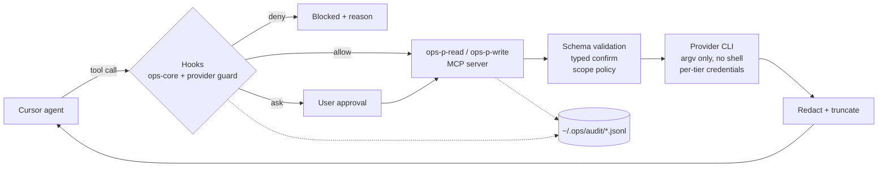

# cursor-ops-plugins

Cursor plugin suite for operating **GitHub, DigitalOcean, Vercel, AWS and Microsoft 365** (Outlook mail, calendar and Teams through Microsoft Graph) from the agent with least privilege. Each provider plugin ships:

| Layer | What it is | Where |
|---|---|---|
| MCP (read) | `ops-<p>-read` server: side-effect-free tools, auto-allowed | `mcp.json`, `provider.ts` |
| MCP (write) | `ops-<p>-write` server: curated mutations, every call needs approval; privileged tools need opt-in + typed confirmation | same |
| Guardrails | `beforeMCPExecution` / `beforeShellExecution` hooks (fail-closed) + server-side validation, scope checks, redaction | `hooks/hooks.json`, `lib/core` |
| Skills | Workflows (triage, release, change sets, DNS, CI) | `skills/*/SKILL.md` |
| Evals | Policy cases, MCP contract cases, live agent scenarios | `evals/*.json` |

`ops-scaffold` generates new **Python, TypeScript and Java** projects from Copier templates kept in this repo (see [Scaffolders](#scaffolders)).

`ops-mermaid` and `ops-latex` are authoring plugins: Mermaid for flowcharts, sequence, state and ER diagrams, and LaTeX/TikZ for documents and complicated figures such as deep-learning architectures (see [Authoring](#authoring-mermaid-and-latex)).

`ops-core` adds cross-cutting guardrails (secret blocking in prompts/commands/MCP args, [safety guardrails](#safety-guardrails) against destructive git, database, filesystem and system commands, risk classification for **third-party** MCP servers such as the official Vercel or GitHub MCP), the audit trail, the operating-model rule, change-management/incident skills and a read-only `ops-investigator` subagent.

`ops-security`, `ops-performance`, `ops-standards` and `ops-docs` review the agent's own work. Once installed, every turn that changes code or docs ends with a review of exactly those changes for security, performance, clean code (current state only, no legacy or dead code) and documentation freshness (see [Automatic code review](#automatic-code-review)).

`ops-control` is the suite's control plane (see [Suite control](#suite-control)): the agent can report what is installed and enabled, query the audit log and review activity, and, with your approval, change review settings and which plugins load.

## Architecture



### Risk tiers

| Tier | Server | Hook decision | Extra controls |
|---|---|---|---|
| `read` | read | allow | read-only credentials; generic gateways (`*_api_get`, `aws_readonly_call`) block secret-returning endpoints |
| `write` | write | ask (shows a human summary of the change) | write credentials; drafts by default (PRs), preview-only redeploys |
| `privileged` | write (only when enabled) | deny unless `allowPrivileged`, then ask | `confirm` must equal the exact target (e.g. `acme/app#42`, `promote:dpl_x`) |

Deliberately **not exposed** as tools: repo/project/cluster/database deletion, instance termination, stack deletion, secret value reads. The shell guards deny the CLI equivalents.

### Defense in depth
1. **Credential separation.** Read and write servers run with different CLI identities, configured in `~/.ops/config.json`.
2. **Tool surface.** The read server cannot list or call write tools. Privileged tools are not registered at all unless enabled.
3. **Hooks.** Cursor asks for or denies MCP calls and CLI commands before they run. Hooks fail closed on crash or timeout.
4. **Server checks.** Each server runs JSON-schema validation (no unknown args, anchored patterns, flag-injection safe), typed confirmation, and scope allowlists (GitHub owners, Vercel team, AWS accounts/regions, DigitalOcean protected tags).
5. **Output hygiene.** Tokens, keys, URL credentials and secret fields are redacted. AWS and DigitalOcean env values are hidden, and output is truncated.
6. **Audit.** Every MCP call, hook decision and shell command is logged as redacted JSONL in `~/.ops/audit/`.

## Repository layout

```
.cursor-plugin/marketplace.json   # team marketplace manifest
packages/core/                    # single source of truth (vendored into each plugin)
plugins/
  ops-core/                       # hooks, rules, skills, agents (no MCP)
  ops-<provider>/
    .cursor-plugin/plugin.json
    provider.ts                   # tool catalog + shell rules (the only provider code)
    mcp.json                      # ops-<p>-read / ops-<p>-write
    hooks/hooks.json
    skills/
    evals/{policy,contract,agent}.json
    lib/core/                     # GENERATED by `pnpm run sync`
  ops-scaffold/                   # scaffold_* tools wrapping Copier + toolchain shell guards
  ops-security/ ops-performance/  # review lenses: hooks, rule, review skill, read-only reviewer subagent
  ops-standards/ ops-docs/        # review lenses for clean code and docs freshness (same layout)
  ops-mermaid/ ops-latex/         # diagram/document rendering, routing rule, authoring skills
  ops-control/                    # suite status, audit and review queries, review and plugin toggles
copier.yml                        # scaffold questions; selects templates/<language>
templates/
  python/ typescript/ java/       # rendered trees (*.jinja files are templated)
  _shared/                        # include-only fragments (license, MCP, rules, skills)
    standards/                    # engineering standards: AGENTS.md sections and the review plugins' rules
evals/run.ts                      # eval harness
scripts/                          # sync, validate, install, doctor, smoke, scaffold, test-templates
```

Plugins are self-contained (core is vendored), so they install from a marketplace without the monorepo. CI fails if `lib/core` drifts from `packages/core`.

## Safety guardrails

`ops-core` checks every agent shell command and every MCP call before it runs (`plugins/ops-core/hooks/guardrails.ts`). **Deny** covers irreversible data loss and attempts to switch off safety controls. **Ask** covers actions that are risky but often legitimate.

| Area | Denied | Asks |
|---|---|---|
| Git | `reset --hard`, `clean -f`, discarding changes (`checkout -- .`, `restore`, `switch --discard-changes`), `stash drop/clear`, reflog expiry, `gc --prune=now`, `filter-branch`/`filter-repo`, `push --mirror`, force-pushing or deleting `main`/`master`/`dev`/`qa`/`staging`/`production`/`release`/`develop`; pushing to an environment branch (`main`, `dev`, `qa`, `staging`), committing while one is checked out, creating branches not named `<user>/<type>/<name>` | other force pushes and remote deletes, `branch -D`, `--no-verify`, changing `core.hooksPath`, `lfs migrate import/export` (history rewrite) |
| Databases | `DROP DATABASE/SCHEMA/TABLE/ROLE`, `TRUNCATE`, `DELETE` without `WHERE`, `FLUSHALL`, `dropDatabase()`, `dropdb`; resets in Prisma, Rails, Laravel, Alembic (`downgrade base`), Flyway, Django, Supabase, EF, Liquibase and others; deleting managed databases (GCP, Azure, Neon, PlanetScale, Fly, Heroku, Atlas); `docker compose down -v` and volume removal; deleting Kubernetes namespaces, PVCs or `--all` | `UPDATE` without `WHERE`, `ALTER TABLE … DROP`, migration rollbacks, `docker system prune`, other `kubectl delete` |
| Infrastructure | `terraform`/`tofu`/`pulumi`/`cdk`/`sst destroy` | `apply -auto-approve`, `state rm/mv`, `pulumi up --yes` |
| Filesystem and system | recursive deletes of `/`, `~`, `.`, `..`, `*`, `.git`, drive roots and system folders; disk formatting and `dd` to devices; secure erase; shutdown and reboot; killing every process; disabling Defender, firewalls or SELinux; deleting registry keys | `curl … \| sh`, `irm … \| iex`, `Set-ExecutionPolicy Bypass` |
| Releases and secrets | | `npm`/`pnpm`/`uv`/`cargo` publish, `gradlew publish`, `docker push`, reading SSH, AWS, kube or Docker credential files, printing access tokens |
| Tampering | writing to or removing `~/.ops/config.json`, the audit log, `.cursor/hooks.json` or installed plugins; setting `OPS_ALLOW_PRIVILEGED` or `OPS_CONFIG` | |

For MCP tools that execute commands or SQL (`execute_sql`, `run_query`, `run_session_command`, …), the same rules run against every string in the tool input. Third-party tools named like `delete_project`, `drop_database` or `destroy_cluster` are denied outright (`thirdPartyMcp.deniedTools`).

To avoid false positives, the guard skips text-only commands (`rg "DROP TABLE"`, `git log --grep …`, `echo`) and ignores the text of commit, PR and issue messages. To relax a single rule, set `guardrails.shell.overrides` in `~/.ops/config.json`, for example `{ "git-reset-hard": "ask" }`. The tamper rules can't be relaxed.

Hooks see the command line, not what a script does after it starts. An agent that writes a script and then runs it is not covered. The operating-model rule forbids that workaround, and the audit log records every command.

## GitOps

Every repository, this one included, follows one branch and release flow:

| Branch | Role | Receives | Merge method |
|---|---|---|---|
| `main` | production | PRs from `dev` (or `qa`/`staging`), Dependabot, release-please | merge commit |
| `dev` | integration | PRs from `<github-user>/<type>/<kebab-name>` branches; the automatic `main → dev` sync | squash (features), merge commit (sync) |
| `qa`, `staging` | optional, only when asked | promotions | merge commit |

Work branch types are `feat`, `fix`, `chore`, `docs`, `refactor`, `perf`, `test`, `build`, `ci`, `style`, `revert` and `hotfix`. PR titles follow Conventional Commits.

The flow is enforced in layers that all work on GitHub Free:
- **CI:** the `pr-policy` workflow checks the target, the branch name (its user part must match the PR author) and the title.
- **Local hooks:** prek's `no-commit-to-branch` blocks commits on environment branches.
- **Agent guardrails:** ops-core denies pushes and commits to environment branches and badly named branches. `github_pr_merge` refuses red checks, work branches into `main`, and squashed promotions.
- **Rulesets:** `github_repo_bootstrap` applies them where the plan allows (public repos on Free, any repo on paid plans). They block deletion and force pushes, require a PR, resolved conversations and `pr-policy`, and set the merge methods. There are no bypass actors.

Releases use [release-please](https://github.com/googleapis/release-please). Conventional commits on `main` produce a release PR, and merging it tags `vX.Y.Z` and publishes the GitHub release. Projects with a Dockerfile then push `ghcr.io/<owner>/<repo>:X.Y.Z` and `:latest` with build provenance; every push to `dev` publishes `:dev` and `:sha-<short>`. After each release or hotfix, `sync-main-to-dev` opens the `main → dev` PR. This repo releases the whole suite under one version: `package.json`, the marketplace and every `plugin.json` are bumped together, and the `vX.Y.Z` tag is the ref Copier scaffolds from.

Workflows on PRs opened with the default `GITHUB_TOKEN` (the release and sync PRs) don't run on their own: GitHub holds them as *action required* until a maintainer clicks **Approve and run**. To skip that step, add a fine-grained token with Contents and Pull requests read/write on the repo as the `GITOPS_TOKEN` Actions secret. The workflows use it when present.

The `gitops-workflow` skill (ops-github) drives this from the agent. `github_repo_create` always asks for the visibility. `github_repo_bootstrap` creates `dev` and any extra environments, sets the merge settings, labels and rulesets, lets Actions open PRs, links a project board, and reports whether `GITOPS_TOKEN` is set. `github_release_list`, `github_project_list` and `github_project_item_add` cover releases and boards. The project tools need the `project` token scope (`gh auth refresh -s project`).

## Microsoft 365

`ops-msgraph` reads and acts on Outlook mail, calendars and Microsoft Teams through Microsoft Graph, using the [CLI for Microsoft 365](https://pnp.github.io/cli-microsoft365/) (`m365`) for sign-in and requests.

- **Read (auto-allowed):** identity and connections, mail list/get/folders, people search, calendars, events (recurrences expanded), meeting-time suggestions, joined teams, channels, chats, and chat and channel messages.
- **Write (always approved):** send, draft, reply, forward, move (including to Deleted Items) and mark mail; create, update, respond to and cancel events; post Teams chat messages, channel posts and thread replies. Nothing hard-deletes.
- **Accounts:** `m365 login --connectionName work|personal` once per account; `msgraph_connection_use` switches. Teams tools need a work or school account.
- **Guards:** `providers.msgraph.scope.allowedRecipientDomains` fences who mail, replies, forwards and invitations can reach. Message and event bodies are treated as untrusted content. The shell guard asks before `m365` sends, removals, raw write requests and Entra changes, and ops-core asks before tokens or the m365 token cache are read.

The `msgraph-setup` skill covers the Entra app registration (delegated permissions), sign-in and troubleshooting; `m365-assistant` covers inbox triage, scheduling and Teams.

## Automatic code review

Each review plugin is one lens. Install any combination, and every agent turn that changes code or docs is reviewed before you take it.

| Lens | Plugin | Reviews | Static hints on added lines |
|---|---|---|---|
| Security | `ops-security` | code and infrastructure files | string-built SQL or shell commands, `eval`, raw HTML sinks, hardcoded secrets, disabled TLS, weak crypto, unsafe deserialization, CORS `*`, workflow script injection, permissive containers |
| Performance | `ops-performance` | code, not tests | queries or `await` inside loops, `forEach(async`, sync I/O, `SELECT *`, unbounded queries, nested scans, JSON clones |
| Standards | `ops-standards` | code, infrastructure and docs, not changelogs | history narration in comments and docs, commented-out code, `legacy`/`V1`/`@deprecated` duplicates, TODO markers, suppressions without a reason, debug leftovers |
| Docs | `ops-docs` | code, infrastructure and docs, not tests or changelogs | docs that still mention an identifier the edit removed, broken relative links, backticked repository paths that don't exist |

1. **While the agent works,** an `afterFileEdit` hook records each changed file and collects the hints.
2. **When the turn finishes,** the `stop` hook sends one follow-up asking for a review of exactly those files, with the hints attached. The agent follows each lens's skill (`security-review`, `performance-review`, `standards-review`, `docs-review`). It fixes clear low-risk issues, lists the rest, and ends with a short **Review** section. Large changes (8+ files) are handed to the read-only reviewer subagents.
3. **It doesn't loop:** fixes made during the review aren't re-reviewed (one round per prompt by default). Lockfiles, generated or vendored code, and changes of fewer than three lines without a hint are skipped.

All lenses share one log per conversation in `~/.ops/review/`, which is pruned after 7 days. Each `stop` hook builds the same combined message, so the plugins never overwrite each other's request. Each plugin also adds an always-on rule (`secure-by-default`, `performance-aware`, `clean-code`, `docs-current`) so the work is done that way in the first place. The standards rule keeps code and docs to the current state only: no history narration, compatibility shims, legacy or dead code; git history is the record. The `docs-review` skill also covers a full-repository stale-docs audit on request. Turn reviews off with `review.enabled: false`, a single lens with `review.lenses.<lens>: false`, or temporarily with `OPS_REVIEW=off`.

## Suite control

`ops-control` runs as `ops-control-read` and `ops-control-write`, like the provider plugins.

| Tool | Tier | What it does |
|---|---|---|
| `control_status` | read | Checkout and branch, loader registration, every plugin's version and enabled state, review settings, which providers have privileged tools on |
| `control_audit` | read | Newest-first audit records, filtered by days, source, decision and text |
| `control_reviews` | read | Per conversation: files and hints each review lens recorded, review requests sent |
| `control_review_set` | write | Reviews or one lens on/off, `maxRounds`, `minChangedLines`, `maxFiles` |
| `control_plugin_set` | write | Whether a plugin loads (`suite.disabledPlugins`); applies after a window reload |

It writes only the `review` and `suite` sections of `~/.ops/config.json`. Guardrail overrides, privileged tools, credentials, scope, third-party MCP policy and the loader itself stay in your hands, and the shell guard still denies the agent from editing those files.

## Authoring (Mermaid and LaTeX)

Both plugins render locally and show the agent its own output: preview tools write PNGs to a temp folder, and the agent reads them to check the layout before it finishes.

| | `ops-mermaid` | `ops-latex` |
|---|---|---|
| Use for | flowcharts, sequence, state, class, ER, Gantt, git graphs, mind maps | documents, papers, equations, and complex figures in TikZ/PGFPlots |
| Read (auto-allowed) | `mermaid_status`, `mermaid_preview` (inline source, a `.mmd` file, or every ```` ```mermaid ```` block in a Markdown file) | `latex_status`, `latex_preview` (a `.tex` file or a TikZ snippet) |
| Write (always approved) | `mermaid_render` to `.svg`, `.png` or `.pdf` | `latex_render` to `.pdf`, `.svg` or `.png` |
| Needs | `pnpm add -g @mermaid-js/mermaid-cli` plus Chrome, Chromium or Edge | MiKTeX or TeX Live (`pdftocairo` from Poppler, or `dvisvgm`, for images) |

**Routing.** The shared `diagram-routing` rule decides by complexity, not by topic. Mermaid gets diagrams that its automatic layout handles well. LaTeX/TikZ gets complicated ones: figures that need precise placement, nested or repeated groups, untangled parallel and skip paths, math labels, 3D blocks or publication quality. Deep-learning architectures are typical, as are detailed block diagrams, circuits and commutative diagrams. `mermaid_preview` and `mermaid_render` add an `advice` field when a Mermaid source shows such signs (math, subgraphs nested three deep, more than 40 edges, spacer links fighting the layout). The `latex-diagrams` skill covers how to design these figures from scratch: layout, styles, routing, grouping, 3D blocks, math annotations and a review checklist.

**Safety.** LaTeX compiles call the engine directly, never latexmk or a `latexmkrc`, with shell escape off, `openout_any=p` (no writes outside the output folder) and MiKTeX's on-the-fly package installer disabled. Missing packages are reported with the `miktex packages install …` or `tlmgr install …` command to run, and the shell guard asks before shell escape or package installs. Mermaid renders with `securityLevel: strict`. Both write tools refuse to overwrite files unless `overwrite` is set, and honor `providers.<p>.scope.allowedRoots`.

## Scaffolders

`copier.yml` and `templates/` form a single [Copier](https://copier.readthedocs.io/) template. The `language` answer selects `templates/<language>` through `_subdirectory`, so the template has one version history and `copier update` works for all three stacks.

| Language | Profiles | Runtime | Toolchain |
|---|---|---|---|
| Python | `simple` (CLI), `backend` (FastAPI, SQLModel, Alembic), `library` | 3.13 | uv, Ruff, ty, pytest, prek, uv_build |
| TypeScript | `next` (Next.js 16 App Router, Turbopack) | Node 24 | pnpm, Biome, TypeScript 7, Vitest + Testing Library, prek |
| Java | `simple`, `backend` (Spring Boot 4, JDBC, Flyway, Postgres, Testcontainers), `library` | 25 | Gradle 9 wrapper (Kotlin DSL, version catalog, foojay toolchains), Spotless/palantir-java-format, Error Prone + NullAway (JSpecify), JUnit 6, prek |

The stack is a standard, not a menu: one package manager and one runtime version per language. This repo follows the same standard: it is a strict TypeScript 7 project on Node 24 with pnpm, Biome, Vitest and prek. Hooks and MCP servers are `.ts` files that Node runs directly (built-in type stripping), so there is no build step and nothing to install at runtime. Bumping a runtime is a template change, and `copier update` rolls it out to existing projects.

Every project gets the same set of shared files:
- `AGENTS.md`, including the suite's engineering standards (clean code and current state only, docs matching the code, secure by default, performance aware). It includes the same text the review plugins enforce, so a project states the standard even where the plugins aren't installed.
- Cursor and/or Claude Code rules
- a `verify` skill that knows the project's commands
- optional Context7/GitHub MCP config (URLs only)
- GitHub Actions CI and Dependabot (conventional `chore(deps)` titles)
- the GitOps workflows (`pr-policy`, `sync-main-to-dev`, `release-please`, and the GHCR `image` workflow when there is a Dockerfile), issue forms, a PR template, release-please config, and an initial commit on `main`
- `.editorconfig` and `.gitattributes`
- `.vscode/extensions.json` recommending the language-server extensions for the project's linters (Ruff and ty, Biome, or Java), so the agent sees their diagnostics while it edits
- an optional Dockerfile for backend and Next.js projects
- optional Git LFS (`git_lfs`, off by default): LFS patterns for media, archives, datasets and model weights in `.gitattributes`, LFS-aware checkouts in CI, and `git lfs install` before the initial commit

Backend profiles (`python/backend`, `java/backend`) also commit `openapi.json` as the API contract, generated from FastAPI or springdoc. A test fails when it is stale (regenerate with `UPDATE_OPENAPI=1`). The `api-compat` workflow diffs it against the base branch with [oasdiff](https://github.com/oasdiff/oasdiff) and fails the PR on error-level breaking changes unless the PR declares them: `!` in the title and a `BREAKING CHANGE:` line in the body. release-please then bumps the major version (minor before 1.0). Changelogs stay with release-please; git-cliff is not used.

**From the agent:** the `scaffold-project` skill interviews the user, always including the project's license, copyright holder and GitHub visibility, and calls `scaffold_create`. It then publishes and bootstraps the repo through `gitops-workflow`. Calls to `scaffold_create` and `scaffold_update` always ask for approval. The tools refuse non-empty destinations, relative paths, and paths outside `providers.scaffold.scope.allowedRoots` when that is set.

**From a shell:**
```powershell
uvx copier copy --trust https://github.com/mujakayadan/cursor-ops-plugins.git D:\Codes\my-app
cd D:\Codes\my-app; uvx copier update --trust      # later, on a clean tree
```

**Toolchain guardrails** (`beforeShellExecution`) apply only inside matching projects. They are detected by marker files from the command's working directory upward:

| Marker | Denied | Asks |
|---|---|---|
| `uv.lock` | `pip install`, `python -m pip install`, `poetry`/`pipenv`/`conda` installs | `uv pip install` |
| `pnpm-lock.yaml` | `npm`/`yarn`/`bun` install, add or remove; `npx`/`bunx` | |
| `biome.json` | | adding ESLint or Prettier |
| `gradlew` | system `gradle`, `mvn` | |

The template source defaults to this repo's GitHub URL. Set `providers.scaffold.source` to a local checkout to try unpushed template changes. Run `pnpm run templates:test` before pushing template changes: it renders every profile and runs that project's own lint, type-check, test, build and prek hooks.

## Setup (any machine)

Requirements: Node 24, pnpm (`corepack enable pnpm`), and whichever CLIs you use (`gh`, `doctl`, `aws`, `vercel`, `m365` from `npm install -g @pnp/cli-microsoft365`).

```powershell
git clone https://github.com/mujakayadan/cursor-ops-plugins.git D:\Codes\cursor-ops-plugins
cd D:\Codes\cursor-ops-plugins
pnpm run install-local   # registers the suite loader in ~/.cursor/hooks.json, creates ~/.ops/config.json
pnpm run doctor          # CLIs, loader, plugins, config, identity per tier
```

`install-local` adds a user-level `workspaceOpen` hook that runs `scripts/workspace-plugins.ts`. When any workspace opens, it returns the paths of every enabled plugin in this checkout, so every project gets the whole suite and `git pull` updates it in place. (Cursor skips links in `~/.cursor/plugins/local` that point elsewhere, so the suite keeps none there.) `pnpm run uninstall-local` removes the hook.

Then run **Developer: Reload Window** in Cursor, and again after each `git pull`. The plugins appear under Customize → Plugins, and the eighteen MCP servers under Settings → MCP.

Configure least-privilege credentials per tier in `~/.ops/config.json`. See `config.example.json` and the `ops-onboarding` skill.

## Distribution

- **Personal (several PCs):** clone the repo and run `pnpm run install-local` on each machine.
- **Team/Enterprise:** in the Cursor Dashboard, go to Plugins & MCPs → Add Marketplace → Import from Repo and point it at this repo (`.cursor-plugin/marketplace.json`). For private repos, enable *Serve marketplace from Cursor*. Local plugin imports may need the admin setting *Allow Local Plugin Imports*.

## Development

```powershell
pnpm install            # dev tools (TypeScript, Biome, Vitest, prek)
pnpm exec prek install  # git hooks: Biome, typecheck, vendoring on commit; tests on push
pnpm run sync           # after editing packages/core or templates/_shared/standards
pnpm run format         # Biome format + safe fixes
pnpm run typecheck      # tsc (strict, no emit)
pnpm test               # Vitest
pnpm run ci             # Biome + typecheck + vendoring + manifest/skill validation + tests + evals
pnpm run smoke          # live read-only calls against your real accounts
pnpm run evals:agent    # live agent scenarios (needs the Cursor CLI; set OPS_AGENT_CMD to override)
pnpm run new-plugin -- cloudflare wrangler "Cloudflare"
pnpm run templates:render   # scaffold structure checks (fast)
pnpm run templates:test     # render every scaffold profile and run its toolchain (needs uv, pnpm, a JDK)
```

To add a tool, add a `tool({...})` entry to the provider's `tools` array with a `tier`, an `input` schema built from the `schema-helpers` (`str`, `int`, `oneOf`, `obj`, ...) and a `run` function. The argument types of `run`, `summarize`, `confirm` and `scope` are inferred from `input`. Mutating tools need `summarize`; privileged tools need `confirm`/`confirmHint`. Then add policy and contract cases. The contract suite enforces naming, tier placement and confirmation automatically.

## Configuration reference

| Key | Default | Purpose |
|---|---|---|
| `providers.<p>.credentials.{read,write}.{env,args}` | `{}` / `[]` | Per-tier CLI identity (e.g. `--profile`, `--context`, `GH_CONFIG_DIR`, `--global-config`) |
| `providers.<p>.allowPrivileged` | `false` | Register + permit privileged tools (`OPS_ALLOW_PRIVILEGED=1` = break-glass) |
| `providers.github.scope.owners` | `[]` | Allowed repo owners |
| `providers.vercel.scope.teamId` / `allowedTeams` | `null` / `[]` | Team scoping for every API call |
| `providers.aws.scope.allowedAccounts` / `allowedRegions`, `defaultRegion` | `[]` | Account/region fences |
| `providers.digitalocean.scope.protectedTags` | `["production"]` | Droplets that privileged tools refuse to touch |
| `providers.scaffold.source` / `ref` | this repo's GitHub URL / latest tag | Copier template location and version |
| `providers.scaffold.scope.allowedRoots` | `[]` (anywhere) | Directories new projects may be created in |
| `providers.msgraph.scope.allowedRecipientDomains` | `[]` (anyone) | Domains (and subdomains) mail, replies, forwards and invitations may reach |
| `providers.msgraph.timeZone` | `null` (this machine's zone) | Default time zone for calendar tools |
| `providers.mermaid.browserPath` | `null` (puppeteer cache, then system Chrome/Edge) | Browser mermaid-cli renders with (`PUPPETEER_EXECUTABLE_PATH` also works) |
| `providers.latex.engine` | `null` (`pdflatex`; `xelatex` for fontspec documents) | Default TeX engine when a call or `% !TEX program` doesn't pick one |
| `providers.{mermaid,latex}.scope.allowedRoots` | `[]` (anywhere) | Directories rendered files may be read from and written to |
| `thirdPartyMcp.{read,write,privileged,unknown}` | allow/ask/ask/allow | Policy for non-ops MCP servers; `serverOverrides` per server regex |
| `thirdPartyMcp.deniedTools` | destroy/drop/delete + database, project, cluster, bucket, repo, … | Tool-name regexes (snake_case-normalized) that are always denied |
| `guardrails.shell.overrides` | `{}` | Per-rule decision (`allow`/`ask`/`deny`) for the [safety guardrails](#safety-guardrails); tamper rules can't be relaxed |
| `prompts.blockSecrets` | `true` | Block prompts containing credentials |
| `review.enabled` / `review.lenses.{security,performance,standards,docs}` | `true` / `true` | Automatic review after turns that change code or docs (`OPS_REVIEW=off` disables it for a session) |
| `review.maxRounds` / `minChangedLines` / `maxFiles` | `1` / `3` / `30` | Review follow-ups per prompt; smallest unhinted change reviewed; files listed per lens |
| `review.ignore` | `[]` | Workspace-relative path regexes never reviewed (dependencies, builds, lockfiles and `lib/core` are always skipped) |
| `audit.{enabled,dir}` | `true`, `~/.ops/audit` | Audit trail |
| `suite.disabledPlugins` | `[]` | Plugins the loader skips (`ops-core` and `ops-control` always load) |

## License

MIT, see [LICENSE](LICENSE). Projects generated by the scaffolder are not covered by it: the agent asks which license each new project gets (MIT, Apache-2.0, or none for proprietary).
