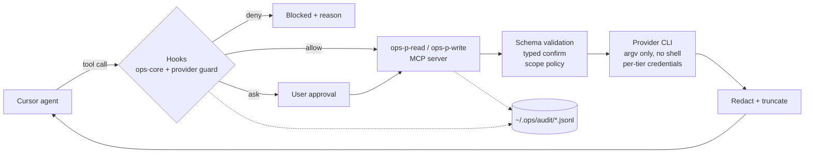

# cursor-ops-plugins

Cursor plugin suite for least-privilege work from the agent. Provider plugins operate external systems. The others scaffold projects, author diagrams and documents, write architecture and delivery plans, review the agent's own changes, remember decisions, vet open source, search the literature, and choose a model. [`.cursor-plugin/marketplace.json`](.cursor-plugin/marketplace.json) is the full list. Each provider plugin ships:

| Layer | What it is | Where |
|---|---|---|
| MCP (read) | `ops-<p>-read` server: side-effect-free tools, auto-allowed, served over loopback HTTP by the shared `ops serve` process | `mcp.json`, `provider.ts` |
| MCP (write) | `ops-<p>-write` server: curated mutations, every call needs approval; privileged tools need opt-in + typed confirmation | same |
| Guardrails | `beforeMCPExecution` / `beforeShellExecution` hooks (fail-closed) + server-side validation, scope checks, redaction | `hooks/hooks.json`, `lib/core` |
| Skills | Workflows (triage, release, change sets, DNS, CI) | `skills/*/SKILL.md` |
| Evals | Policy cases, MCP contract cases, live agent scenarios | `evals/*.json` |

`ops-scaffold` generates new **Python, TypeScript and Java** projects from Copier templates kept in this repo (see [Scaffolders](#scaffolders)).

`ops-mermaid` and `ops-latex` are authoring plugins: Mermaid for flowcharts, sequence, state and ER diagrams, and LaTeX/TikZ for documents and complicated figures such as deep-learning architectures (see [Authoring](#authoring-mermaid-and-latex)).

`ops-architecture` writes the architecture and delivery plan of a new or existing application, after interviewing you on what is still open. The set is `ARCHITECTURE.md`, ADRs, a runbook and a `TODO.md` that traces every requirement and syncs to GitHub issues. Its platform diagrams use the official AWS, Azure, Google Cloud and Kubernetes icons (see [Architecture and delivery plans](#architecture-and-delivery-plans)).

`ops-core` adds cross-cutting guardrails (secret blocking in prompts/commands/MCP args, [safety guardrails](#safety-guardrails) against destructive git, database, filesystem and system commands, risk classification for **third-party** MCP servers such as the official Vercel or GitHub MCP), the audit trail, the operating-model rule, change-management/incident skills and a read-only `ops-investigator` subagent.

`ops-security`, `ops-performance`, `ops-standards` and `ops-docs` review the agent's own work. Once installed, every turn that changes code or docs ends with a review of exactly those changes for security, performance, clean code (current state only, no legacy or dead code) and documentation freshness (see [Automatic code review](#automatic-code-review)).

`ops-control` is the suite's control plane (see [Suite control](#suite-control)): the agent can report what is installed and enabled, query the audit log and review activity, and, with your approval, change review settings, which plugins load and your user profile.

The agent knows who it works with (see [User profile and memory](#user-profile-and-memory)): your expertise level and lasting preferences set how it communicates and what it asks, `ops-yarba` reads the published portfolio when a site token is configured, and `ops-memory` keeps a knowledge graph of projects, decisions and vetted components across conversations. `ops-oss` vets open source from public data (license, OpenSSF Scorecard, advisories, vulnerable dependencies, provenance), and its `oss-research` skill finds exemplar systems and reusable components when a project starts (see [Open-source research](#open-source-research)). `ops-research` searches the literature and writes BibTeX; `ops-latex` compiles the paper (see [Literature](#literature)).

## Get started

On any machine with Cursor, tell the agent:

> Set up https://github.com/mujakayadan/cursor-ops-plugins on this machine.

The agent follows [AGENTS.md](AGENTS.md#set-up-the-suite-on-this-machine): it installs Git, Node and pnpm if needed, clones the repo, installs the suite and the provider CLIs, and after the restart it checks everything with `ops doctor` and fixes what fails. You do three things: accept the approval prompts, quit and reopen Cursor once when asked, and complete the provider sign-ins it hands you in the terminal (browser, device code or pasted token, so no credential passes through the chat). To do it by hand, see [Setup](#setup-any-machine).

## Architecture



### Risk tiers

| Tier | Server | Hook decision | Extra controls |
|---|---|---|---|
| `read` | read | allow | read-only credentials; generic gateways (`*_api_get`, `aws_readonly_call`) block secret-returning endpoints |
| `write` | write | ask (shows a human summary of the change) | write credentials; drafts by default (PRs), preview-only redeploys |
| `privileged` | write (only when enabled) | deny unless `allowPrivileged`, then ask | `confirm` must equal the exact target (e.g. `acme/app#42`, `promote:dpl_x`) |

Deliberately **not exposed** as tools: repo/project/cluster/database deletion, instance termination, stack deletion, secret value reads. The shell guards deny the CLI equivalents.

### Defense in depth
1. **Credential separation.** Read and write servers run with different CLI identities, configured in `~/.ops/config.json`.
2. **Tool surface.** The read server cannot list or call write tools. Privileged tools are not registered at all unless enabled. Write servers run on stdio, so only Cursor, behind its hooks, can call them; the shared read server requires a bearer token.
3. **Hooks.** Cursor asks for or denies MCP calls and CLI commands before they run. Hooks fail closed on crash or timeout.
4. **Server checks.** Each server runs JSON-schema validation (no unknown args, anchored patterns, flag-injection safe), typed confirmation, and scope allowlists (GitHub owners, Vercel team, AWS accounts/regions, DigitalOcean protected tags).
5. **Output hygiene.** Tokens, keys, URL credentials and secret fields are redacted. AWS and DigitalOcean env values are hidden, and output is truncated.
6. **Audit.** Every MCP call, hook decision and shell command is logged as redacted JSONL in `~/.ops/audit/`.

## Repository layout

```
.cursor-plugin/marketplace.json   # team marketplace manifest
packages/core/                    # single source of truth (vendored into each plugin)
plugins/
  ops-core/                       # hooks, rules, skills, agents (no MCP)
  ops-<name>/                     # one plugin; marketplace.json is the inventory
    .cursor-plugin/plugin.json
    provider.ts                   # tools and shell rules, when the plugin has them
    mcp.json                      # ops-<name>-read / ops-<name>-write, generated with the tools
    hooks/hooks.json
    skills/
    evals/                        # policy cases; contract and agent cases when the plugin has them
    lib/core/                     # GENERATED by `pnpm run sync`
AGENTS.md                         # agent guide: setting up a machine, changing the suite
copier.yml                        # scaffold questions; selects templates/<language>
templates/
  python/ typescript/ java/       # rendered trees (*.jinja files are templated)
  _shared/                        # include-only fragments (license, MCP, rules, skills)
    standards/                    # engineering standards: AGENTS.md sections and the review plugins' rules
evals/run.ts                      # eval harness
scripts/                          # ops command (install, setup, doctor, serve), sync, validate, smoke, scaffold, test-templates
```

Plugins are self-contained (core is vendored), so they install from a marketplace without the monorepo. CI fails if `lib/core` drifts from `packages/core`.

## Safety guardrails

`ops-core` checks every agent shell command and every MCP call before it runs (`plugins/ops-core/hooks/guardrails.ts`). **Deny** covers irreversible data loss and attempts to switch off safety controls. **Ask** covers actions that are risky but often legitimate.

| Area | Denied | Asks |
|---|---|---|
| Git | `reset --hard`, `clean -f`, discarding changes (`checkout -- .`, `restore`, `switch --discard-changes`), `stash drop/clear`, reflog expiry, `gc --prune=now`, `filter-branch`/`filter-repo`, `push --mirror`, force-pushing or deleting `main`/`master`/`dev`/`qa`/`staging`/`production`/`release`/`develop`; pushing to an environment branch (`main`, `dev`, `qa`, `staging`), committing while one is checked out, creating branches not named `<user>/<type>/<name>` | other force pushes and remote deletes, `branch -D`, `--no-verify`, changing `core.hooksPath`, `lfs migrate import/export` (history rewrite) |
| Databases | `DROP DATABASE/SCHEMA/TABLE/ROLE`, `TRUNCATE`, `DELETE` without `WHERE`, `FLUSHALL`, `dropDatabase()`, `dropdb`; resets in Prisma, Rails, Laravel, Alembic (`downgrade base`), Flyway, Django, Supabase, EF, Liquibase and others; deleting managed databases (GCP, Azure, Neon, PlanetScale, Fly, Heroku, Atlas); `docker compose down -v` and volume removal; deleting Kubernetes namespaces, PVCs or `--all` | `UPDATE` without `WHERE`, `ALTER TABLE … DROP`, migration rollbacks, `docker system prune`, other `kubectl delete` |
| Infrastructure | `terraform`/`tofu`/`pulumi`/`cdk`/`sst destroy` | `apply -auto-approve`, `state rm/mv`, `pulumi up --yes` |
| Filesystem and system | recursive deletes of `/`, `~`, `.`, `..`, `*`, `.git`, drive roots and system folders; disk formatting and `dd` to devices; secure erase; shutdown and reboot; killing every process; disabling Defender, firewalls or SELinux; deleting registry keys | `curl … \| sh`, `irm … \| iex`, `Set-ExecutionPolicy Bypass` |
| Releases and secrets | | `npm`/`pnpm`/`uv`/`cargo` publish, `gradlew publish`, `docker push`, reading SSH, AWS, kube or Docker credential files, printing access tokens |
| Tampering | writing to or removing `~/.ops/config.json`, the audit log, `.cursor/hooks.json` or installed plugins; setting `OPS_ALLOW_PRIVILEGED` or `OPS_CONFIG` | |

For MCP tools that execute commands or SQL (`execute_sql`, `run_query`, `run_session_command`, …), the same rules run against every string in the tool input. Third-party tools named like `delete_project`, `drop_database` or `destroy_cluster` are denied outright (`thirdPartyMcp.deniedTools`).

To avoid false positives, the guard skips text-only commands (`rg "DROP TABLE"`, `git log --grep …`, `echo`) and ignores the text of commit, PR and issue messages. To relax a single rule, set `guardrails.shell.overrides` in `~/.ops/config.json`, for example `{ "git-reset-hard": "ask" }`. The tamper rules can't be relaxed.

Hooks see the command line, not what a script does after it starts. An agent that writes a script and then runs it is not covered. The operating-model rule forbids that workaround, and the audit log records every command.

## GitOps

Every repository, this one included, follows one branch and release flow:

| Branch | Role | Receives | Merge method |
|---|---|---|---|
| `main` | production | PRs from `dev` (or `qa`/`staging`), Dependabot, release-please | merge commit (user approves `github_pr_merge`, or merges it) |
| `dev` | integration | PRs from `<github-user>/<type>/<kebab-name>` branches; the automatic `main → dev` sync | squash (agent merges features), merge commit (agent merges sync) |
| `qa`, `staging` | optional, only when asked | promotions | merge commit |

Work branch types are `feat`, `fix`, `chore`, `docs`, `refactor`, `perf`, `test`, `build`, `ci`, `style`, `revert` and `hotfix`. PR titles follow Conventional Commits. Each PR covers one concern; leave unrelated dirty files out of the commit. Concurrent agents use linked git worktrees so they do not share a working tree. In this suite, that is `ops worktree add <user>/<type>/<name>` (creates `<repo>-wt/<user>/<type>/<kebab>` beside the primary checkout); other repos use plain `git worktree add`. After the pull request merges, the agent removes that worktree and deletes the local work branch. Environment branches stay. This suite's shared read server tracks git HEAD and refreshes on `ops status`, `ops doctor` and workspace open.

The flow is enforced in layers that all work on GitHub Free:
- **CI:** the `pr-policy` workflow checks the target, the branch name (its user part must match the PR author) and the title.
- **Local hooks:** prek's `no-commit-to-branch` blocks commits on environment branches; each repo's push hooks run its lint and tests (in this suite: biome and tsc on commit, vitest on push).
- **Agent guardrails:** ops-core denies pushes and commits to environment branches and badly named branches. `github_pr_merge` refuses red checks, work branches into `main`, and squashed promotions.
- **Rulesets:** `github_repo_bootstrap` applies them where the plan allows (public repos on Free, any repo on paid plans). They block deletion and force pushes, require a PR, resolved conversations and `pr-policy`, and set the merge methods. There are no bypass actors.

Releases use [release-please](https://github.com/googleapis/release-please). Conventional commits on `main` produce a release PR, and merging it tags `vX.Y.Z` and publishes the GitHub release. Projects with a Dockerfile then push `ghcr.io/<owner>/<repo>:X.Y.Z` and `:latest` with build provenance; every push to `dev` publishes `:dev` and `:sha-<short>`. After each release or hotfix, `sync-main-to-dev` opens the `main → dev` PR. This repo releases the whole suite under one version: `package.json`, the marketplace and every `plugin.json` are bumped together, and the `vX.Y.Z` tag is the ref Copier scaffolds from.

Workflows on PRs opened with the default `GITHUB_TOKEN` (the release and sync PRs) don't run on their own: GitHub holds them as *action required* until a maintainer clicks **Approve and run**. To skip that step, add a fine-grained token with Contents and Pull requests read/write on the repo as the `GITOPS_TOKEN` Actions secret. The workflows use it when present.

The `gitops-workflow` skill (ops-github) drives this from the agent. Agents squash-merge their own work PRs into `dev` once checks are green, and open the `dev` → `main` promote PR when the suite should ship. A pull request into `main` merges when the user approves `github_pr_merge`, or when the user merges it. The agent does not merge those with `gh pr merge`. `github_repo_create` always asks for the visibility. `github_repo_bootstrap` creates `dev` and any extra environments, sets the merge settings, labels and rulesets, lets Actions open PRs, links a project board, and reports whether `GITOPS_TOKEN` is set. `github_release_list`, `github_project_list` and `github_project_item_add` cover releases and boards. `github_issues_import` creates a delivery plan's epics and tasks as issues in one approved call (see [Architecture and delivery plans](#architecture-and-delivery-plans)). The project tools need the `project` token scope (`gh auth refresh -s project`).

## Microsoft 365

`ops-msgraph` reads and acts on Outlook mail, calendars and Microsoft Teams through Microsoft Graph, using the [CLI for Microsoft 365](https://pnp.github.io/cli-microsoft365/) (`m365`) for sign-in and requests.

- **Read (auto-allowed):** identity and connections, mail list/get/folders, people search, calendars, events (recurrences expanded), meeting-time suggestions, joined teams, channels, chats, and chat and channel messages.
- **Write (always approved):** send, draft (optional local file attachments, at most 10 files and 25 MB each; over 3 MB uses a Graph upload session; `msgraph_mail_attach` adds more to an existing draft), reply, forward, move (including to Deleted Items) and mark mail; create, update, respond to and cancel events; post Teams chat messages, channel posts and thread replies. Nothing hard-deletes.
- **Accounts:** `m365 login --connectionName work|personal` once per account; `msgraph_connection_use` switches. Teams tools need a work or school account.
- **Guards:** `providers.msgraph.scope.allowedRecipientDomains` fences who mail, replies, forwards and invitations can reach. Message and event bodies are treated as untrusted content. The shell guard asks before `m365` sends, removals, raw write requests and Entra changes, and ops-core asks before tokens or the m365 token cache are read.

The `msgraph-setup` skill covers the Entra app registration (delegated permissions), sign-in and troubleshooting; `m365-assistant` covers inbox triage, scheduling and Teams.

## Google

`ops-google` reads and acts on Gmail, Google Calendar, contacts (People), Meet and Drive through [gog](https://gogcli.sh/) (`gog`). Google Chat is out of scope.

- **Read (auto-allowed):** identity and auth list, Gmail search/get/labels, contacts search, calendars, events, free/busy, Meet space get/history/participants, Drive list/search/get/tree.
- **Write (always approved):** send, draft, reply, forward, trash, archive and mark mail; create, update, respond to and delete events (optional Meet link); create/update/end Meet spaces; create Drive folders, share and trash files. Nothing permanently deletes Drive or mail outside Trash.
- **Accounts:** `gog auth credentials` then `gog auth add you@gmail.com --services gmail,calendar,drive,contacts,people,meet` (repeat for each mailbox). Tools auto-pick when several are stored (`providers.google.account` or first by email); pass `account` to target another.
- **Guards:** `providers.google.scope.allowedRecipientDomains` fences who mail, invitations and Drive shares may reach. Message and event bodies are untrusted content. The shell guard asks before `gog` sends, deletes, shares or changes auth.

The `google-setup` skill covers the Google Cloud OAuth desktop client, API enablement, sign-in and troubleshooting; `google-assistant` covers inbox triage, scheduling and Drive.

## Automatic code review

Each review plugin is one lens. Install any combination, and every agent turn that changes code or docs is reviewed before you take it.

| Lens | Plugin | Reviews | Static hints on added lines |
|---|---|---|---|
| Security | `ops-security` | code and infrastructure files | string-built SQL or shell commands, `eval`, raw HTML sinks, hardcoded secrets, disabled TLS, weak crypto, unsafe deserialization, CORS `*`, workflow script injection, permissive containers |
| Performance | `ops-performance` | code, not tests | queries or `await` inside loops, `forEach(async`, sync I/O, `SELECT *`, unbounded queries, nested scans, JSON clones |
| Standards | `ops-standards` | code, infrastructure and docs, not changelogs | history narration in comments and docs, commented-out code, `legacy`/`V1`/`@deprecated` duplicates, TODO markers, suppressions without a reason, debug leftovers, personal or machine-specific paths |
| Docs | `ops-docs` | code, infrastructure and docs, not tests or changelogs | docs that still mention an identifier the edit removed, broken relative links, backticked repository paths that don't exist |

1. **While the agent works,** an `afterFileEdit` hook records each changed file and collects the hints.
2. **When the turn finishes,** the `stop` hook sends one follow-up asking for a review of exactly those files, with the hints attached. The agent follows each lens's skill (`security-review`, `performance-review`, `standards-review`, `docs-review`). It fixes clear low-risk issues, lists the rest, and ends with a short **Review** section. Large changes (8+ files) are handed to the read-only reviewer subagents.
3. **It doesn't loop:** fixes made during the review aren't re-reviewed (one round per prompt by default). Lockfiles, generated or vendored code, and changes of fewer than three lines without a hint are skipped.

All lenses share one log per conversation in `~/.ops/review/`, which is pruned after 7 days. Each `stop` hook builds the same combined message, so the plugins never overwrite each other's request. Each plugin also adds an always-on rule (`secure-by-default`, `performance-aware`, `clean-code`, `docs-current`) so the work is done that way in the first place. The standards rule keeps code and docs to the current state only: no history narration, compatibility shims, legacy or dead code; git history is the record. It also keeps them portable: no one person's paths, names, accounts or time zones in shared code, docs or examples. The `docs-review` skill also covers a full-repository stale-docs audit on request. Turn reviews off with `review.enabled: false`, a single lens with `review.lenses.<lens>: false`, or temporarily with `OPS_REVIEW=off`.

## Suite control

`ops-control` runs as `ops-control-read` and `ops-control-write`, like the provider plugins.

| Tool | Tier | What it does |
|---|---|---|
| `control_status` | read | Checkout and branch, loader registration, every plugin's version and enabled state, review settings, which providers have privileged tools on |
| `control_audit` | read | Newest-first audit records, filtered by days, source, decision and text |
| `control_reviews` | read | Per conversation: files and hints each review lens recorded, review requests sent |
| `control_review_set` | write | Reviews or one lens on/off, `maxRounds`, `minChangedLines`, `maxFiles` |
| `control_plugin_set` | write | Whether a plugin loads (`suite.disabledPlugins`); applies after a window reload |
| `control_profile_get` | read | The user profile and where it is stored |
| `control_profile_set` | write | Expertise level, role and lasting preferences (see [User profile and memory](#user-profile-and-memory)) |

It writes only the `review` and `suite` sections of `~/.ops/config.json` and the profile in `~/.ops/profile.json`. Guardrail overrides, privileged tools, credentials, scope, third-party MCP policy and the loader itself stay in your hands, and the shell guard still denies the agent from editing those files.

## User profile and memory

`~/.ops/profile.json` holds your expertise level (`senior-engineer`, `engineer`, `technical` or `non-technical`), an optional role and up to 20 short preferences. The `ops-core` `sessionStart` hook turns it into context at the start of every conversation, so the agent adapts without being told: for a senior engineer it talks peer to peer, resolves what it can, asks only the calls that are yours as trade-offs with a recommended option, and finishes work instead of listing what remains. Without a profile, the agent asks once which level describes you and saves the answer with `control_profile_set`. The profile belongs to the OS user, so each person on a shared machine or team gets their own.

`ops-memory` is a knowledge graph in `~/.ops/memory/graph.json` (`OPS_MEMORY_FILE` overrides the path), using the data model of the reference MCP memory server: named, typed entities with dated observations, and typed relations between them. Every entity has a scope (`global`, `user` or `project:<owner>/<repo>`) so searches stay within a project.

| Tool | Tier | What it does |
|---|---|---|
| `memory_status` | read | Path, entity and relation counts per scope and type |
| `memory_search` | read | Entities ranked by query matches in name, type and observations, with their relations |
| `memory_open` | read | Entities by name with their relations |
| `memory_remember` | write | Create or update entities, add observations and relations |
| `memory_forget` | write | Delete entities, observations or relations |

Writes need approval, so content from a web page or an issue can't plant facts without you seeing them, and both the `ops-core` hook and the tool reject credentials. Concurrent writers are serialized with a lock file and every write replaces the file atomically. The `memory` skill covers what to recall at the start of a task and what is worth recording.

`ops-yarba` reads the published [YARBA](https://yarba.app) portfolio. The default API is `https://api.yarba.app`. `YARBA_API_URL` overrides it and must be https, or http on localhost. The token is the portfolio site token, sent as `X-Portfolio-Site-Token` and never logged or returned. An agent access token is not accepted. The portfolio is not copied into the knowledge graph. The `yarba-portfolio` skill reads it once per conversation and treats the text as data.

`ops-rea` pins the upstream [REA](https://github.com/morluto/rea) (`rea-agents`) MCP for the team marketplace without reimplementing its tools. Enable the plugin, restart Cursor, and use the `rea` server under Settings → MCP. Bump the version in `plugins/ops-rea/mcp.json` to follow upstream.

`ops-inhouse` talks to [Inhouse](https://www.inhouse.ai) over HTTPS (`https://api.inhouse.ai` by default) with a Bearer access token in `INHOUSE_ACCESS_TOKEN` (never paste the token into chat; do not use `setx`, which truncates long JWTs). Run `node plugins/ops-inhouse/login.ts` from the checkout to open the site and store the token, then quit/reopen Cursor. It lists threads, reads messages, lists the document library, and uploads evidence via presigned URLs. Endpoints are not a published partner API and can change. Outbound mail with attachments stays on `ops-msgraph`.

| Tool | Tier | What it does |
|---|---|---|
| `yarba_status` | read | Whether `YARBA_PORTFOLIO_TOKEN` is set, and the API host |
| `yarba_portfolio` | read | Published personal details, summary, life story, work, education, skills, projects, awards and publications |

## Model routing

`ops-models` picks the model and effort for a task from the signed-in plan and the included-usage headroom. `models_account` reads both from the Cursor CLI (`agent about`, `agent models`). `models_route` then chooses.

Included models (Grok 4.7, Grok 4.6, Grok 4.5, Composer 2.5) draw from the subscription pool. Composer 2.5 is the default for routine and parallel work. Grok 4.7 at medium effort is the default for implementation. High effort is for hard tasks and for frontier tasks that stay on Grok, and only on Premium and above while more than 40% of the included pool remains. Fast mode is always off. When the only high-effort subagent id is a high-fast slug, that id is what `taskModel` returns. Third-party models are not in the pool. Naming one bills from prepaid credit when the CLI lists any third-party model, and also when the model list is missing on Premium and above. Plus keeps effort at medium. With no CLI, or a model list that contains only included models, routing stays on included models.

The chat model is the picker. The route selects a subagent model when the session allowlist has a matching id; otherwise the subagent inherits the chat model. With no CLI installed the plan is unknown and routing stays on included models at medium effort. Install and `agent login` are documented at [cursor.com/docs/cli/installation](https://cursor.com/docs/cli/installation). The tool does not read Cursor's local auth database.

## Open-source research

`ops-oss` answers whether a package or repository is safe to depend on, using public data without credentials: [deps.dev](https://deps.dev) for versions, licenses, provenance attestations and dependency graphs, [OSV](https://osv.dev) for advisories on the version and every transitive dependency, and [OpenSSF Scorecard](https://scorecard.dev) for security practices.

| Tool | Tier | What it does |
|---|---|---|
| `oss_package` | read | One package version (npm, PyPI, Maven, Cargo, Go, NuGet, RubyGems): license class, deprecation, release age, advisories with CVSS, vulnerable dependencies, source repository, Scorecard and flags |
| `oss_project` | read | One GitHub, GitLab or Bitbucket repository: stars, license, Scorecard checks, the packages it publishes and flags |

The `oss-research` skill runs when a project starts (the architecture blueprint calls it after the interview) or before a significant dependency is added. It frames the capability areas, discovers candidates on GitHub, registries and curated lists, vets each against license compatibility, maintenance, Scorecard, advisories, supply chain and fit, and studies one to three exemplar systems read-only. Each candidate gets Adopt, Trial or Reject; the verdicts fill section 16 of `ARCHITECTURE.md`, which `architecture_check` requires, and the knowledge graph, so a later project reuses recent verdicts.

## Literature

`ops-research` finds real works and writes citations. It queries [OpenAlex](https://openalex.org), [arXiv](https://arxiv.org) and [Semantic Scholar](https://www.semanticscholar.org), deduplicates on DOI, then arXiv id, then title. OpenAlex and Semantic Scholar include an open-access PDF link only when that API returned one. An arXiv record includes `https://arxiv.org/pdf/<id>`. An empty result means the indexes had nothing. The plugin does not invent a paper, and it does not store abstracts or PDFs in the knowledge graph.

| Tool | Tier | What it does |
|---|---|---|
| `research_search` | read | Search one or more indexes. Computer science uses all three; other fields use OpenAlex and Semantic Scholar, plus arXiv where that field circulates preprints |
| `research_paper` | read | Resolve one DOI, arXiv id, OpenAlex id or Semantic Scholar id |
| `research_related` | read | One hop of references, citations, or both, capped at 15 per direction |
| `research_save` | write | Re-resolve ids and append BibTeX to a `.bib` file. Skips a DOI or cite key already present. Needs approval |

`research_save` builds the BibTeX itself. A model-written entry is not an argument. Optional environment variables raise quotas and are never logged: `OPENALEX_MAILTO` (an email in the OpenAlex polite pool) and `SEMANTIC_SCHOLAR_API_KEY`. The `research-workflow` skill runs the sequence, then the agent drafts and `ops-latex` compiles.

## Authoring (Mermaid and LaTeX)

Both plugins render locally and show the agent its own output: preview tools write PNGs to a temp folder, and the agent reads them to check the layout before it finishes.

| | `ops-mermaid` | `ops-latex` |
|---|---|---|
| Use for | flowcharts, sequence, state, class, ER, Gantt, git graphs, mind maps | documents, papers, equations, and complex figures in TikZ/PGFPlots |
| Read (auto-allowed) | `mermaid_status`, `mermaid_preview` (inline source, a `.mmd` file, or every ```` ```mermaid ```` block in a Markdown file) | `latex_status`, `latex_preview` (a `.tex` file or a TikZ snippet) |
| Write (always approved) | `mermaid_render` to `.svg`, `.png` or `.pdf` | `latex_render` to `.pdf`, `.svg` or `.png` |
| Needs (`ops setup`) | mermaid-cli plus Chrome, Chromium or Edge | MiKTeX or TeX Live (`pdftocairo` from Poppler, or `dvisvgm`, for images; `ops setup --optional`) |

**Routing.** The shared `diagram-routing` rule sends deployment and infrastructure views with cloud service icons to `ops-architecture` (see [Architecture and delivery plans](#architecture-and-delivery-plans)). Everything else it decides by complexity, not by topic. Mermaid gets diagrams that its automatic layout handles well. LaTeX/TikZ gets complicated ones: figures that need precise placement, nested or repeated groups, untangled parallel and skip paths, math labels, 3D blocks or publication quality. Deep-learning architectures are typical, as are detailed block diagrams, circuits and commutative diagrams. `mermaid_preview` and `mermaid_render` add an `advice` field when a Mermaid source shows such signs (math, subgraphs nested three deep, more than 40 edges, spacer links fighting the layout). The `latex-diagrams` skill covers how to design these figures from scratch: layout, styles, routing, grouping, 3D blocks, math annotations and a review checklist.

**Safety.** LaTeX compiles call the engine directly, never latexmk or a `latexmkrc`, with shell escape off, `openout_any=p` (no writes outside the output folder) and MiKTeX's on-the-fly package installer disabled. Missing packages are reported with the `miktex packages install …` or `tlmgr install …` command to run, and the shell guard asks before shell escape or package installs. Mermaid renders with `securityLevel: strict`. Both write tools refuse to overwrite files unless `overwrite` is set, and honor `providers.<p>.scope.allowedRoots`.

## Architecture and delivery plans

After scaffolding an application, `scaffold-project` hands over to the `architecture-blueprint` skill. You can also ask for it in an existing repository. The agent first reads the repository and the conversation, then asks you about every open decision in up to three short forms:
- actors and use cases;
- load, latency, availability, RPO and RTO;
- cloud, regions and compute model;
- data classification, compliance, identity and tenancy;
- integrations, observability, budget, team and dates.

Unknown numbers become proposals you confirm, never guesses. The output is written so a developer can build, deploy and operate the system from it alone:

| File | Contents |
|---|---|
| `ARCHITECTURE.md` | 19 sections: context and scope, requirements (`FR-01`, `NFR-01` with measurable targets), use cases, C4 system context and containers, platform deployment, runtime flows, data, interfaces, security with a STRIDE threat model, observability and SLOs, scalability, resilience and DR, environments and delivery, cost, open source and dependencies (each component vetted with its license, Scorecard and verdict, plus the exemplars studied), decisions, risks, glossary |
| `docs/adr/NNNN-*.md` | One record per significant decision with the alternatives considered; it states the decision in force and is rewritten when the decision changes |
| `docs/runbook.md` | Deploy, rollback, configuration and secrets, monitoring and alerts, incident response, backup and restore, disaster recovery, routine operations |
| `docs/architecture/<view>.diagram.json` + `.png`/`.svg` | Platform diagrams with official service icons |
| `TODO.md` | Milestones with a Gantt chart, a definition of done, and epics of tasks of at most 3 days. Each task has its milestone, dependencies, the requirements and sections it traces, an estimate, implementation notes and checkbox acceptance criteria |

Use-case, C4, sequence, ER, state and Gantt diagrams are Mermaid blocks that GitHub renders inline. Platform diagrams are JSON specs drawn with the Python [`diagrams`](https://diagrams.mingrammer.com/) library and Graphviz. Its icon sets cover AWS, Azure, Google Cloud, Kubernetes, DigitalOcean, OCI, on-prem and SaaS services. Accounts, regions, VPCs, subnets and namespaces become nested clusters.

| Tool | Tier | What it does |
|---|---|---|
| `architecture_status` | read | Whether uv and Graphviz are installed (`ops setup ops-architecture`) |
| `architecture_icons` | read | The icon classes of a provider, filtered by a search term |
| `architecture_preview` | read | Validates a spec and draws it to a throwaway PNG the agent reads |
| `architecture_render` | write | Draws a spec to the PNG or SVG next to it; SVGs embed their icons |
| `architecture_check` | read | See below |

`architecture_check` checks the whole set:
- every required section and diagram type is present;
- every requirement is traced by a task, and every reference points to a defined requirement, task or milestone;
- every task has its fields, a valid estimate and acceptance criteria, and dependencies have no cycles;
- ADRs have the required sections, a valid status and a link from `ARCHITECTURE.md`;
- every platform diagram is rendered and newer than its spec;
- relative links resolve, and no placeholder or template guide comment is left.

Once you approve the plan, `github_issues_import` (ops-github) creates the milestones, then the task and epic issues, each title starting with its key (`T-012 …`) and labelled `plan`. Epic bodies link their tasks' issues, and new issues can go onto a Project board. Keys that already have a `plan` issue are skipped, so a later run adds only new tasks. An existing epic that gains a task gets the line naming that task appended to its body; nothing else in an existing issue changes. The agent writes each issue number back into `TODO.md`. The generated project's `AGENTS.md` keeps both documents current: a design change updates `ARCHITECTURE.md` and its ADR, and the pull request that completes a task checks its acceptance criteria and references its issue, which closes when the change is promoted to `main`.

**Safety.** A spec is data: the renderer is a fixed script that resolves icons by name inside the `diagrams` package, so previews run no workspace code and are auto-allowed. `diagrams` is pinned, and uv runs it in an isolated environment without touching the project. Renders and issue imports need approval, and `providers.architecture.scope.allowedRoots` limits which folders the tools read and write.

## Scaffolders

`copier.yml` and `templates/` form a single [Copier](https://copier.readthedocs.io/) template. The `language` answer selects `templates/<language>` through `_subdirectory`, so the template has one version history and `copier update` works for all three stacks.

| Language | Profiles | Runtime | Toolchain |
|---|---|---|---|
| Python | `package` (typed src layout), `backend` (FastAPI, SQLModel, Alembic) | 3.13 | uv, Ruff, ty, pytest, prek, uv_build |
| TypeScript | `next` (Next.js 16 App Router, Turbopack) | Node 24 | pnpm, Biome, TypeScript 7, Vitest + Testing Library, prek |
| Java | `simple` (main class), `backend` (Spring Boot 4, JDBC, Flyway, Postgres, Testcontainers), `library` (package tree) | 25 | Gradle 9 wrapper (Kotlin DSL, version catalog, foojay toolchains), Spotless/palantir-java-format, Error Prone + NullAway (JSpecify), JUnit 6, prek |

The stack is a standard, not a menu: one package manager and one runtime version per language. This repo follows the same standard: it is a strict TypeScript 7 project on Node 24 with pnpm, Biome, Vitest and prek. Hooks and MCP servers are `.ts` files that Node runs directly (built-in type stripping), so there is no build step and nothing to install at runtime. Bumping a runtime is a template change, and `copier update` rolls it out to existing projects. Packages, actions and base images are pinned to an exact version, a commit SHA or an image digest, and Dependabot opens the bumps. Python keeps a lower bound beside `uv.lock`. Runner images stay on `ubuntu-latest`.

Every project gets the same set of shared files:
- `AGENTS.md`, including the suite's engineering standards (clean code and current state only, docs matching the code, secure by default, performance aware). It includes the same text the review plugins enforce, so a project states the standard even where the plugins aren't installed.
- Cursor and/or Claude Code rules
- a `verify` skill that knows the project's commands
- optional Context7/GitHub MCP config (URLs only)
- GitHub Actions CI and Dependabot (conventional `chore(deps)` titles)
- the GitOps workflows (`pr-policy`, `sync-main-to-dev`, `release-please`, and the GHCR `image` workflow when there is a Dockerfile), issue forms, a PR template, release-please config, and an initial commit on `main`
- `.editorconfig` and `.gitattributes`
- `.vscode/extensions.json` recommending the language-server extensions for the project's linters (Ruff and ty, Biome, or Java), so the agent sees their diagnostics while it edits
- an optional Dockerfile for backend and Next.js projects
- optional Git LFS (`git_lfs`, off by default): LFS patterns for media, archives, datasets and model weights in `.gitattributes`, LFS-aware checkouts in CI, and `git lfs install` before the initial commit

Backend profiles (`python/backend`, `java/backend`) also commit `openapi.json` as the API contract, generated from FastAPI or springdoc. A test fails when it is stale (regenerate with `UPDATE_OPENAPI=1`). The `api-compat` workflow diffs it against the base branch with [oasdiff](https://github.com/oasdiff/oasdiff) and fails the PR on error-level breaking changes unless the PR declares them: `!` in the title and a `BREAKING CHANGE:` line in the body. release-please then bumps the major version (minor before 1.0). Changelogs stay with release-please; git-cliff is not used.

**From the agent:** the `scaffold-project` skill interviews the user, always including the project's license, copyright holder and GitHub visibility, and calls `scaffold_create`. It then publishes and bootstraps the repo through `gitops-workflow`, and hands over to `architecture-blueprint` for the architecture and delivery plan. Calls to `scaffold_create` and `scaffold_update` always ask for approval. The tools refuse non-empty destinations, relative paths, and paths outside `providers.scaffold.scope.allowedRoots` when that is set.

**From a shell:**
```sh
uvx copier copy --trust https://github.com/mujakayadan/cursor-ops-plugins.git $HOME/code/my-app
cd $HOME/code/my-app; uvx copier update --trust      # later, on a clean tree
```

**Toolchain guardrails** (`beforeShellExecution`) apply only inside matching projects. They are detected by marker files from the command's working directory upward:

| Marker | Denied | Asks |
|---|---|---|
| `uv.lock` | `pip install`, `python -m pip install`, `poetry`/`pipenv`/`conda` installs | `uv pip install` |
| `pnpm-lock.yaml` | `npm`/`yarn`/`bun` install, add or remove; `npx`/`bunx` | |
| `biome.json` | | adding ESLint or Prettier |
| `gradlew` | system `gradle`, `mvn` | |

The template source defaults to this repo's GitHub URL. Set `providers.scaffold.source` to a local checkout to try unpushed template changes. Run `pnpm run templates:test` before pushing template changes: it renders every profile and runs that project's own lint, type-check, test, build and prek hooks.

## Setup (any machine)

Requirements: Git, Node 24 or newer, and pnpm (`winget install --id pnpm.pnpm --exact` or `brew install pnpm`). The suite has no runtime dependencies, so there is nothing to `pnpm install` unless you develop it.

```sh
git clone https://github.com/mujakayadan/cursor-ops-plugins.git $HOME/code/cursor-ops-plugins
cd $HOME/code/cursor-ops-plugins
node scripts/ops.ts install   # suite loader for Cursor, the `ops` command, ~/.ops/config.json
node scripts/ops.ts setup     # install the CLIs the enabled plugins need
# quit and reopen Cursor, then in a new terminal:
ops doctor                    # CLIs, loader, read server, config, sign-in per tier, with a fix for each failure
```

`ops install` does four things:
- adds a user-level `workspaceOpen` hook that runs `scripts/workspace-plugins.ts`. When any workspace opens, it starts the shared read server if needed, then returns the paths of every enabled plugin in this checkout, so every project gets the whole suite and `git pull` updates it in place. (Cursor skips links in `~/.cursor/plugins/local` that point elsewhere, so the suite keeps none there.)
- creates the read server's token (`~/.ops/serve.token`, a random local secret, not a provider credential) and sets it as the `OPS_MCP_TOKEN` user environment variable.
- writes the `ops` launcher to `~/.ops/bin` and adds that folder to your user PATH. On macOS and Linux it prints the two profile lines instead; `--no-user-env` skips both.
- creates `~/.ops/config.json` from `config.example.json` if it doesn't exist.

Then **quit and reopen Cursor once**, so it picks up `OPS_MCP_TOKEN`. After that, Developer: Reload Window is enough, including after each `git pull`. The plugins appear under Customize → Plugins, and their MCP servers under Settings → MCP. `ops uninstall` removes the hook, the token, the launcher and the PATH entry.

| Command | What it does |
|---|---|
| `ops status` | Checkout, loader, read server, plugins and review settings; refreshes the read server when HEAD moved |
| `ops setup [--optional] [--yes] [--dry-run] [plugin...]` | Installs missing CLIs for the enabled plugins. Each provider declares its recipes in `provider.ts` (`setup`). npm-based CLIs go into `~/.ops/tools` with pnpm (no admin rights, no PATH change); others use winget on Windows or Homebrew elsewhere. `--optional` adds feature-only tools such as Poppler and a JDK |
| `ops doctor [--json]` | Runtime, loader, token, read server, config, plugins, and per provider its CLIs, toolchain and sign-in per credential tier. Refreshes a stale read server first. Every failure comes with a fix; sign-in fixes come from the provider's `onboarding` in `provider.ts`. `--json` is for agents |
| `ops serve [--background\|--stop\|--restart]` | The shared read server; foreground by default, logs to `~/.ops/serve.log` |
| `ops worktree add\|list\|remove …` | Linked suite checkouts for concurrent agents (`<repo>-wt/<user>/<type>/<kebab>` from `origin/dev`; see `ops worktree --help`) |
| `ops agent [args...]` | The Cursor CLI agent (`agent`) with every enabled suite plugin passed as `--plugin-dir` |
| `ops install [--no-user-env]` / `ops uninstall` | Registers or removes the loader hook, the read server token, the `ops` launcher and its PATH entry (see above) |

The MCP servers look for CLIs in `~/.ops/tools` first, then PATH, then on Windows the PATH stored in the registry and known install folders under Program Files (Graphviz), so tools installed while Cursor is running are found on the next call without a restart.

### How the MCP servers run

- **Read tiers** share one long-running process, `ops serve`, on `http://127.0.0.1:47821/mcp/<provider>` (Streamable HTTP). Every window, chat and the terminal agent use it, so read tools start instantly and the server keeps warm state. The loader hook starts it before Cursor loads the plugins, and restarts it when the checkout moves to another commit. It answers loopback host names only, rejects requests from web pages, and requires `Authorization: Bearer $OPS_MCP_TOKEN`, which each plugin's `mcp.json` sends from `${env:OPS_MCP_TOKEN}`.
- **Write tiers** stay on stdio: Cursor starts one process per window, and nothing else can reach it, so every change passes Cursor's approval hooks.

`pnpm run sync` generates every provider's `mcp.json` this way.

Configure least-privilege credentials per tier in `~/.ops/config.json`. See `config.example.json` and the `ops-onboarding` skill.

## Distribution

- **Personal (several PCs):** on each machine, ask the agent to set it up (see [Get started](#get-started)), or clone the repo and run `node scripts/ops.ts install`.
- **Team/Enterprise:** in the Cursor Dashboard, go to Plugins & MCPs → Add Marketplace → Import from Repo and point it at this repo (`.cursor-plugin/marketplace.json`). For private repos, enable *Serve marketplace from Cursor*. Local plugin imports may need the admin setting *Allow Local Plugin Imports*.

## Development

```powershell
pnpm install            # dev tools (TypeScript, Biome, Vitest, prek)
pnpm exec prek install  # git hooks: Biome, typecheck, vendoring on commit; tests on push
pnpm run sync           # after editing packages/core or templates/_shared/standards
pnpm run format         # Biome format + safe fixes
pnpm run typecheck      # tsc (strict, no emit)
pnpm test               # Vitest
pnpm run ci             # Biome + typecheck + vendoring + manifest/skill validation + tests + evals
pnpm run smoke          # live read-only calls against your real accounts
pnpm run evals:agent    # live agent scenarios (needs the Cursor CLI; set OPS_AGENT_CMD to override)
pnpm run new-plugin -- cloudflare wrangler "Cloudflare"
pnpm run templates:render   # scaffold structure checks (fast)
pnpm run templates:test     # render every scaffold profile and run its toolchain (needs uv, pnpm, a JDK)
```

To add a tool, add a `tool({...})` entry to the provider's `tools` array with a `tier`, an `input` schema built from the `schema-helpers` (`str`, `int`, `oneOf`, `obj`, ...) and a `run` function. The argument types of `run`, `summarize`, `confirm` and `scope` are inferred from `input`. Mutating tools need `summarize`; privileged tools need `confirm`/`confirmHint`. Then add policy and contract cases. The contract suite enforces naming, tier placement and confirmation automatically. Each provider also declares `setup` (how `ops setup` installs its CLIs) and, where it needs a sign-in or a local toolchain, `onboarding` (the read tool that proves readiness, the sign-in command, and its setup skill). `test/providers.test.ts` covers every provider plugin: it requires a recipe for every binary and checks that the onboarding tools and skill exist.

## Configuration reference

| Key | Default | Purpose |
|---|---|---|
| `providers.<p>.credentials.{read,write}.{env,args}` | `{}` / `[]` | Per-tier CLI identity (e.g. `--profile`, `--context`, `GH_CONFIG_DIR`, `--global-config`) |
| `providers.<p>.allowPrivileged` | `false` | Register + permit privileged tools (`OPS_ALLOW_PRIVILEGED=1` = break-glass) |
| `providers.github.scope.owners` | `[]` | Allowed repo owners |
| `providers.vercel.scope.teamId` / `allowedTeams` | `null` / `[]` | Team scoping for every API call |
| `providers.aws.scope.allowedAccounts` / `allowedRegions`, `defaultRegion` | `[]` | Account/region fences |
| `providers.digitalocean.scope.protectedTags` | `["production"]` | Droplets that privileged tools refuse to touch |
| `providers.scaffold.source` / `ref` | this repo's GitHub URL / latest tag | Copier template location and version |
| `providers.scaffold.scope.allowedRoots` | `[]` (anywhere) | Directories new projects may be created in |
| `providers.msgraph.scope.allowedRecipientDomains` | `[]` (anyone) | Domains (and subdomains) mail, replies, forwards and invitations may reach |
| `providers.msgraph.timeZone` | `null` (this machine's zone) | Default time zone for calendar tools |
| `providers.google.scope.allowedRecipientDomains` | `[]` (anyone) | Domains (and subdomains) Gmail, invitations and Drive shares may reach |
| `providers.google.timeZone` | `null` (this machine's zone) | Default time zone for calendar create |
| `providers.mermaid.browserPath` | `null` (puppeteer cache, then system Chrome/Edge) | Browser mermaid-cli renders with (`PUPPETEER_EXECUTABLE_PATH` also works) |
| `providers.latex.engine` | `null` (`pdflatex`; `xelatex` for fontspec documents) | Default TeX engine when a call or `% !TEX program` doesn't pick one |
| `providers.{mermaid,latex}.scope.allowedRoots` | `[]` (anywhere) | Directories rendered files may be read from and written to |
| `thirdPartyMcp.{read,write,privileged,unknown}` | allow/ask/ask/allow | Policy for non-ops MCP servers; `serverOverrides` per server regex |
| `thirdPartyMcp.deniedTools` | destroy/drop/delete + database, project, cluster, bucket, repo, … | Tool-name regexes (snake_case-normalized) that are always denied |
| `guardrails.shell.overrides` | `{}` | Per-rule decision (`allow`/`ask`/`deny`) for the [safety guardrails](#safety-guardrails); tamper rules can't be relaxed |
| `prompts.blockSecrets` | `true` | Block prompts containing credentials |
| `review.enabled` / `review.lenses.{security,performance,standards,docs}` | `true` / `true` | Automatic review after turns that change code or docs (`OPS_REVIEW=off` disables it for a session) |
| `review.maxRounds` / `minChangedLines` / `maxFiles` | `1` / `3` / `30` | Review follow-ups per prompt; smallest unhinted change reviewed; files listed per lens |
| `review.ignore` | `[]` | Workspace-relative path regexes never reviewed (dependencies, builds, lockfiles and `lib/core` are always skipped) |
| `audit.{enabled,dir}` | `true`, `~/.ops/audit` | Audit trail |
| `suite.disabledPlugins` | `[]` | Plugins the loader skips (`ops-core` and `ops-control` always load) |

## License

MIT, see [LICENSE](LICENSE). Projects generated by the scaffolder are not covered by it: the agent asks which license each new project gets (MIT, Apache-2.0, or none for proprietary).
