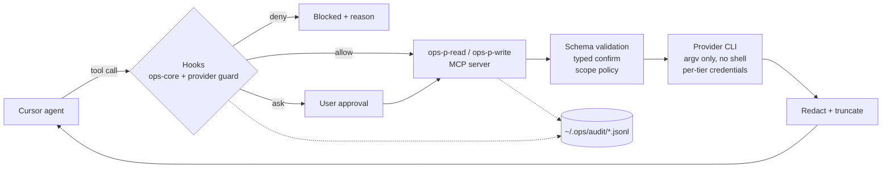

# cursor-ops-plugins

Cursor plugin suite for operating **GitHub, DigitalOcean, Vercel and AWS** from the agent with least privilege. Each provider plugin ships:

| Layer | What it is | Where |
|---|---|---|
| MCP (read) | `ops-<p>-read` server: side-effect-free tools, auto-allowed | `mcp.json`, `provider.mjs` |
| MCP (write) | `ops-<p>-write` server: curated mutations, every call needs approval; privileged tools need opt-in + typed confirmation | same |
| Guardrails | `beforeMCPExecution` / `beforeShellExecution` hooks (fail-closed) + server-side validation, scope checks, redaction | `hooks/hooks.json`, `lib/core` |
| Skills | Workflows (triage, release, change sets, DNS, CI) | `skills/*/SKILL.md` |
| Evals | Policy cases, MCP contract cases, live agent scenarios | `evals/*.json` |

`ops-scaffold` generates new **Python, TypeScript and Java** projects from Copier templates kept in this repo (see [Scaffolders](#scaffolders)).

`ops-core` adds cross-cutting guardrails (secret blocking in prompts/commands/MCP args, generic destructive-shell rules, risk classification for **third-party** MCP servers such as the official Vercel or GitHub MCP), the audit trail, the operating-model rule, change-management/incident skills and a read-only `ops-investigator` subagent.

## Architecture



### Risk tiers

| Tier | Server | Hook decision | Extra controls |
|---|---|---|---|
| `read` | read | allow | read-only credentials; generic gateways (`*_api_get`, `aws_readonly_call`) block secret-returning endpoints |
| `write` | write | ask (shows a human summary of the change) | write credentials; drafts by default (PRs), preview-only redeploys |
| `privileged` | write (only when enabled) | deny unless `allowPrivileged`, then ask | `confirm` must equal the exact target (e.g. `acme/app#42`, `promote:dpl_x`) |

Deliberately **not exposed** as tools: repo/project/cluster/database deletion, instance termination, stack deletion, secret value reads. The shell guards deny the CLI equivalents.

### Defense in depth
1. **Credential separation.** Read and write servers run with different CLI identities, configured in `~/.ops/config.json`.
2. **Tool surface.** The read server cannot list or call write tools. Privileged tools are not registered at all unless enabled.
3. **Hooks.** Cursor asks for or denies MCP calls and CLI commands before they run. Hooks fail closed on crash or timeout.
4. **Server checks.** Each server runs JSON-schema validation (no unknown args, anchored patterns, flag-injection safe), typed confirmation, and scope allowlists (GitHub owners, Vercel team, AWS accounts/regions, DigitalOcean protected tags).
5. **Output hygiene.** Tokens, keys, URL credentials and secret fields are redacted. AWS and DigitalOcean env values are hidden, and output is truncated.
6. **Audit.** Every MCP call, hook decision and shell command is logged as redacted JSONL in `~/.ops/audit/`.

## Repository layout

```
.cursor-plugin/marketplace.json   # team marketplace manifest
packages/core/                    # single source of truth (vendored into each plugin)
plugins/
  ops-core/                       # hooks, rules, skills, agents (no MCP)
  ops-<provider>/
    .cursor-plugin/plugin.json
    provider.mjs                  # tool catalog + shell rules (the only provider code)
    mcp.json                      # ops-<p>-read / ops-<p>-write
    hooks/hooks.json
    skills/
    evals/{policy,contract,agent}.json
    lib/core/                     # GENERATED by `pnpm run sync`
  ops-scaffold/                   # scaffold_* tools wrapping Copier + toolchain shell guards
copier.yml                        # scaffold questions; selects templates/<language>
templates/
  python/ typescript/ java/       # rendered trees (*.jinja files are templated)
  _shared/                        # include-only fragments (license, MCP, rules, skills)
evals/run.mjs                     # eval harness
scripts/                          # sync, validate, install, doctor, smoke, scaffold, test-templates
```

Plugins are self-contained (core is vendored), so they install from a marketplace without the monorepo. CI fails if `lib/core` drifts from `packages/core`.

## Scaffolders

`copier.yml` and `templates/` form a single [Copier](https://copier.readthedocs.io/) template. The `language` answer selects `templates/<language>` through `_subdirectory`, so the template has one version history and `copier update` works for all three stacks.

| Language | Profiles | Runtime | Toolchain |
|---|---|---|---|
| Python | `simple` (CLI), `backend` (FastAPI, SQLModel, Alembic), `library` | 3.13 | uv, Ruff, ty, pytest, prek, uv_build |
| TypeScript | `next` (Next.js 16 App Router, Turbopack) | Node 24 | pnpm, Biome, TypeScript 7, Vitest + Testing Library, prek |
| Java | `simple`, `backend` (Spring Boot 4, JDBC, Flyway, Postgres, Testcontainers), `library` | 25 | Gradle 9 wrapper (Kotlin DSL, version catalog, foojay toolchains), Spotless/palantir-java-format, Error Prone + NullAway (JSpecify), JUnit 6, prek |

The stack is a standard, not a menu: one package manager and one runtime version per language. This repo follows the same standard; it is a pnpm project on Node 24. Bumping a runtime is a template change, and `copier update` rolls it out to existing projects.

Every project gets the same set of shared files:
- `AGENTS.md`
- Cursor and/or Claude Code rules
- a `verify` skill that knows the project's commands
- optional Context7/GitHub MCP config (URLs only)
- GitHub Actions CI and Dependabot
- `.editorconfig` and `.gitattributes`
- an optional Dockerfile for backend and Next.js projects

**From the agent:** the `scaffold-project` skill interviews the user and calls `scaffold_create`. Calls to `scaffold_create` and `scaffold_update` always ask for approval. The tools refuse non-empty destinations, relative paths, and paths outside `providers.scaffold.scope.allowedRoots` when that is set.

**From a shell:**
```powershell
uvx copier copy --trust https://github.com/mujakayadan/cursor-ops-plugins.git D:\Codes\my-app
cd D:\Codes\my-app; uvx copier update --trust      # later, on a clean tree
```

**Toolchain guardrails** (`beforeShellExecution`) apply only inside matching projects. They are detected by marker files from the command's working directory upward:

| Marker | Denied | Asks |
|---|---|---|
| `uv.lock` | `pip install`, `python -m pip install`, `poetry`/`pipenv`/`conda` installs | `uv pip install` |
| `pnpm-lock.yaml` | `npm`/`yarn`/`bun` install, add or remove; `npx`/`bunx` | |
| `biome.json` | | adding ESLint or Prettier |
| `gradlew` | system `gradle`, `mvn` | |

The template source defaults to this repo's GitHub URL. Set `providers.scaffold.source` to a local checkout to try unpushed template changes. Run `pnpm run templates:test` before pushing template changes: it renders every profile and runs that project's own lint, type-check, test, build and prek hooks.

## Setup (any machine)

Requirements: Node 24, pnpm (`corepack enable pnpm`), and whichever CLIs you use (`gh`, `doctl`, `aws`, `vercel`).

```powershell
git clone https://github.com/mujakayadan/cursor-ops-plugins.git D:\Codes\cursor-ops-plugins
cd D:\Codes\cursor-ops-plugins
pnpm run install-local   # junctions into ~/.cursor/plugins/local, creates ~/.ops/config.json
pnpm run doctor          # CLIs, install, config, identity per tier
```

Then run **Developer: Reload Window** in Cursor. The plugins appear under Customize → Plugins, and the eight MCP servers under Settings → MCP. Because the install uses junctions, `git pull` updates the plugins in place; reload Cursor afterwards.

Configure least-privilege credentials per tier in `~/.ops/config.json`. See `config.example.json` and the `ops-onboarding` skill.

## Distribution

- **Personal (several PCs):** clone the repo and run `pnpm run install-local` on each machine.
- **Team/Enterprise:** in the Cursor Dashboard, go to Plugins & MCPs → Add Marketplace → Import from Repo and point it at this repo (`.cursor-plugin/marketplace.json`). For private repos, enable *Serve marketplace from Cursor*. Local plugin imports may need the admin setting *Allow Local Plugin Imports*.

## Development

```powershell
pnpm run sync           # after editing packages/core
pnpm run ci             # vendoring check + manifest/skill validation + unit tests + evals
pnpm run smoke          # live read-only calls against your real accounts
pnpm run evals:agent    # live agent scenarios (needs the Cursor CLI; set OPS_AGENT_CMD to override)
pnpm run new-plugin -- cloudflare wrangler "Cloudflare"
pnpm run templates:render   # scaffold structure checks (fast)
pnpm run templates:test     # render every scaffold profile and run its toolchain (needs uv, pnpm, a JDK)
```

To add a tool, add an entry to the provider's `tools` array with a `tier`, an `input` schema and a `run` function. Mutating tools need `summarize`; privileged tools need `confirm`/`confirmHint`. Then add policy and contract cases. The contract suite enforces naming, tier placement and confirmation automatically.

## Configuration reference

| Key | Default | Purpose |
|---|---|---|
| `providers.<p>.credentials.{read,write}.{env,args}` | `{}` / `[]` | Per-tier CLI identity (e.g. `--profile`, `--context`, `GH_CONFIG_DIR`, `--global-config`) |
| `providers.<p>.allowPrivileged` | `false` | Register + permit privileged tools (`OPS_ALLOW_PRIVILEGED=1` = break-glass) |
| `providers.github.scope.owners` | `[]` | Allowed repo owners |
| `providers.vercel.scope.teamId` / `allowedTeams` | `null` / `[]` | Team scoping for every API call |
| `providers.aws.scope.allowedAccounts` / `allowedRegions`, `defaultRegion` | `[]` | Account/region fences |
| `providers.digitalocean.scope.protectedTags` | `["production"]` | Droplets that privileged tools refuse to touch |
| `providers.scaffold.source` / `ref` | this repo's GitHub URL / latest tag | Copier template location and version |
| `providers.scaffold.scope.allowedRoots` | `[]` (anywhere) | Directories new projects may be created in |
| `thirdPartyMcp.{read,write,privileged,unknown}` | allow/ask/ask/allow | Policy for non-ops MCP servers; `serverOverrides` per server regex |
| `prompts.blockSecrets` | `true` | Block prompts containing credentials |
| `audit.{enabled,dir}` | `true`, `~/.ops/audit` | Audit trail |
