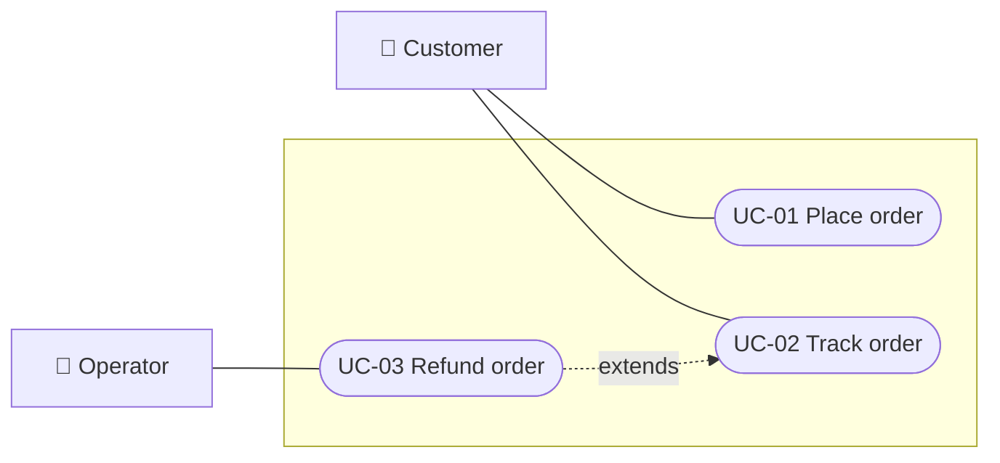
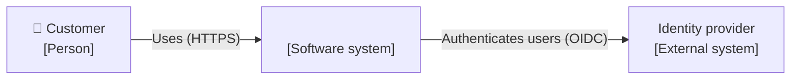
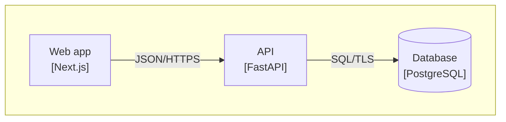
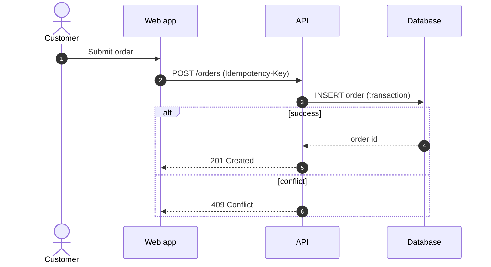
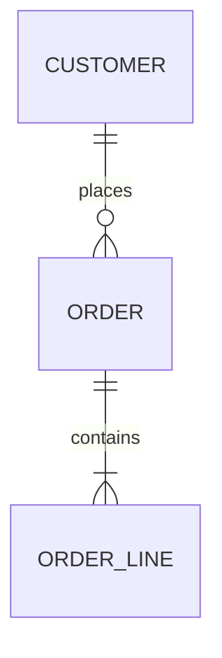

# <System name> architecture

<!-- guide: One paragraph: what the system does, for whom, and the business outcome it serves. Every
statement in this document is a decision a developer can build against. Write it in the present tense.
Delete every guide comment as you fill a section; architecture_check rejects leftovers. -->

| | |
|---|---|
| Owner | <!-- guide: team or role that owns the system --> |
| Repository | <!-- guide: OWNER/NAME --> |
| Platform | <!-- guide: e.g. AWS (us-east-1 primary, us-west-2 recovery) --> |
| Status | <!-- guide: Proposed until the user approves it, then Accepted --> |

## 1. Context and scope

<!-- guide: The problem, the users, what is in scope and what is explicitly out of scope, the
business constraints (deadline, budget, team size, regulations) and the success metrics with targets. -->

### In scope

### Out of scope

### Constraints

### Success metrics

| Metric | Target | Measured by |
|---|---|---|

## 2. Requirements

<!-- guide: Every requirement has an ID that TODO.md tasks trace. Functional requirements say what
a user or system can do. Non-functional ones are measurable: metric, target and how it is measured.
Cover availability, latency, throughput, scalability, durability (RPO), recovery time (RTO),
security, privacy, compliance, accessibility, localization and supportability. -->

### Functional

| ID | Requirement | Actor | Priority |
|---|---|---|---|
| FR-01 | | | Must |

### Non-functional

| ID | Quality | Requirement | Target | Measured by |
|---|---|---|---|---|
| NFR-01 | Availability | | 99.9% monthly | |

## 3. Use cases

<!-- guide: A use-case diagram: actors outside the system boundary, use cases inside it as rounded
nodes, include/extend as labelled dotted links. Then a table with each use case's actor, trigger,
main flow, alternate flows and the requirements it realizes. -->

| ID | Use case | Actor | Trigger | Main flow | Alternate flows | Realizes |
|---|---|---|---|---|---|---|

## 4. System context

<!-- guide: C4 level 1: the system as one box, its users and every external system it talks to,
each link labelled with purpose and protocol. -->

## 5. Containers

<!-- guide: C4 level 2: every deployable unit (web app, API, workers, databases, queues, caches) with
its technology, responsibility and the protocol of each link. Follow with one subsection per
container: responsibility, technology and version, interfaces it exposes and consumes, data it owns,
scaling unit, and the source folder in this repository. -->

## 6. Deployment

<!-- guide: The platform view with official service icons, drawn from a spec in
docs/architecture/<name>.diagram.json (platform-diagrams skill) and rendered next to it. Show
accounts or subscriptions, regions, network boundaries (VPC/VNet, subnets, availability zones), edge
services, compute, data stores, messaging, identity, secrets, observability and CI/CD. Then a table of
every cloud service: purpose, configuration (size, capacity, multi-AZ), and the environment-specific
settings. Add one diagram per environment shape that differs (for example production vs. preview). -->

| Service | Purpose | Configuration | Environments |
|---|---|---|---|

## 7. Runtime flows

<!-- guide: One sequence diagram per critical flow (sign-in, the main business transaction, an
asynchronous job, a failure and retry path). Show every participant from the container view, the
protocol of each call, alt blocks for the main failure cases, and where idempotency, retries,
timeouts and transactions apply. -->

### Place order

## 8. Data

<!-- guide: The data model (ER diagram with keys and cardinality), then per entity: owner container,
classification (public, internal, confidential, PII, PCI, PHI), retention and deletion, encryption,
and the access pattern that drives indexes. Include state machines for entities with a lifecycle,
migrations strategy, backups and data residency. -->

| Entity | Owner | Classification | Retention | Encryption | Key access patterns |
|---|---|---|---|---|---|

## 9. Interfaces

<!-- guide: Every API and event the system exposes or consumes: style (REST, GraphQL, gRPC, events),
the contract file (openapi.json for backend profiles), authentication, versioning and compatibility
rules, pagination, error format (RFC 9457 problem details), rate limits, and event schemas with their
topics and delivery guarantees. -->

## 10. Security

<!-- guide: Identity and access (authentication, authorization model, service identities, least
privilege), secrets management, encryption in transit and at rest, network controls, supply chain
(dependency and image scanning), audit logging, compliance mapping, and a STRIDE threat model per
trust boundary. Every mitigation is a TODO.md task or an existing control. -->

### Threat model

| Boundary | Threat (STRIDE) | Scenario | Mitigation | Task |
|---|---|---|---|---|

## 11. Observability

<!-- guide: SLIs and SLOs with error budgets, the metrics, logs and traces each container emits
(OpenTelemetry where possible), correlation IDs, dashboards, and every alert with its threshold,
severity and the runbook section that handles it. -->

| SLI | SLO | Window | Alert | Runbook |
|---|---|---|---|---|

## 12. Scalability and performance

<!-- guide: Expected load (users, requests per second at peak, data growth), the scaling dimension of
each container, auto-scaling rules, caching, capacity limits and quotas, and the load tests that prove
the latency and throughput targets. -->

## 13. Resilience and disaster recovery

<!-- guide: Failure modes and their handling (timeouts, retries with backoff, circuit breakers,
bulkheads, dead-letter queues), RPO and RTO per data store, backup and restore, multi-AZ and
multi-region strategy, and the DR drill schedule. -->

| Failure | Impact | Detection | Handling | RTO |
|---|---|---|---|---|

## 14. Environments and delivery

<!-- guide: Environments (dev, staging, production, previews) with their accounts and differences,
infrastructure as code (tool, layout, state), the CI/CD pipeline from pull request to production,
the GitOps branch model of this repository, release and rollback, feature flags and database
migration rollout. -->

## 15. Cost

<!-- guide: Monthly estimate per service and environment with the assumptions behind it, the cost
drivers, budgets and alerts, and the levers that reduce cost at scale. -->

| Service | Environment | Assumption | Monthly estimate |
|---|---|---|---|

## 16. Decisions

<!-- guide: One line per architecture decision record, linked. -->

| ADR | Decision | Status |
|---|---|---|
| [0001](docs/adr/0001-record-architecture-decisions.md) | Record architecture decisions | Accepted |

## 17. Risks

<!-- guide: Technical and delivery risks with likelihood, impact, mitigation and owner. Open
questions are not risks: resolve them with the user before the document is accepted. -->

| Risk | Likelihood | Impact | Mitigation | Owner |
|---|---|---|---|---|

## 18. Glossary

| Term | Meaning |
|---|---|
