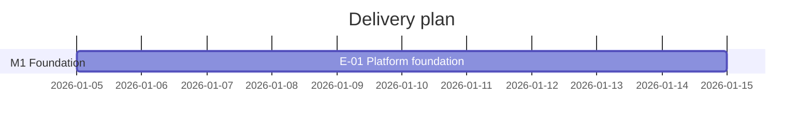

# <System name> delivery plan

<!-- guide: The plan that takes the repository from scaffold to production, written so a developer
can pick up any task without asking. Tasks trace requirements (FR/NFR) and ARCHITECTURE.md
sections; architecture_check verifies that every requirement is covered. Delete every guide
comment as you fill a section. -->

## Milestones

<!-- guide: Typical milestones: M1 Foundation (accounts, IaC, CI/CD, observability baseline,
walking skeleton deployed to every environment), M2 Core features, M3 Hardening (security,
load tests, DR drill, accessibility), M4 Launch (runbook rehearsed, go-live checklist). Each has
exit criteria a reviewer can verify. -->

| ID | Milestone | Exit criteria | Target date (YYYY-MM-DD) |
|---|---|---|---|
| M1 | Foundation | | |

## Definition of done

Every task is done when all of these hold, in addition to its own acceptance criteria:

- [ ] Code, tests and infrastructure changes are merged into `dev` through a reviewed pull request with green CI.
- [ ] Unit tests cover the new behavior; integration or end-to-end tests cover every changed interface.
- [ ] The change is deployed to the dev environment and verified there.
- [ ] Metrics, logs and traces for the new behavior exist, and any new alert has a runbook entry.
- [ ] `ARCHITECTURE.md`, the runbook and the API contract match the change; a new decision has an ADR.
- [ ] Security review findings are fixed; no secrets, personal data or debug code are committed.
- [ ] The task's acceptance criteria here are checked and the pull request references its issue (`Closes #n`).

## E-01 Platform foundation

<!-- guide: One epic per coherent outcome. One or two sentences of goal, then its tasks. Tasks are
at most 3 days, ordered by dependency, and include infrastructure, CI/CD, security, observability,
testing and documentation work, not only features. Each threat-model mitigation, alert and runbook
procedure appears in some task. -->

### T-001 Provision accounts and networking with infrastructure as code

- **Milestone:** M1
- **Depends on:** none
- **Traces:** NFR-01, ARCHITECTURE.md §6 Deployment
- **Estimate:** 2d

<!-- guide: Implementation notes: the modules, files and resources to create, the configuration
values and conventions to follow, and links to the exact ARCHITECTURE.md sections and ADRs. Enough
for a developer who has read ARCHITECTURE.md to start without asking. -->

**Acceptance criteria**

- [ ] <!-- guide: Observable, testable outcomes, such as "terraform plan in CI shows no drift" -->
